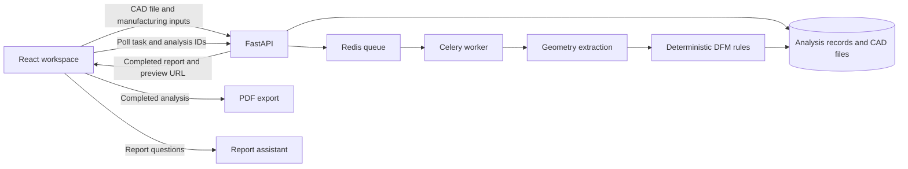

# FaberAI architecture

FaberAI reviews STEP/STP and STL parts for injection molding and 3D printing.
The primary interface is the React application. FastAPI coordinates storage,
Celery runs geometry and deterministic DFM checks, and Redis carries background
jobs. Start the system with the root [quick start](README.md#run-locally).

## Analysis flow

STEP analysis also produces an STL preview for the browser. The worker persists
geometry, process scores, rule findings, and preview URLs together. Polling prefers
completed database records when Celery's result state lags behind storage.

## Module map

| Location | Responsibility |
| --- | --- |
| `frontend/src/pages/` | Landing, projects, uploads, analysis workspace, and settings |
| `frontend/src/components/workspace/steps/` | Setup, inspection, verdict, and export views |
| `frontend/src/hooks/useFileWorkspace.ts` | File-scoped analysis, settings, and preview selection shared by wizard steps |
| `frontend/src/components/ModelPreview/` | Three.js rendering, CAD imports, issue markers, and viewer controls |
| `frontend/src/lib/` | API calls, task polling, file processing, and report display helpers |
| `frontend/src/store/` | Zustand project, workspace, theme, and interaction state |
| `backend/main.py` | HTTP routes, validation, error responses, startup, and dependency checks |
| `backend/app/crud.py` | Analysis record persistence through SQLite or Supabase |
| `backend/app/services/storage.py` | Shared upload, preview storage, and CAD file reads |
| `backend/app/local_store.py` | SQLite records and files in the local data directory |
| `backend/core/workers.py` | Background geometry, preview, and DFM orchestration |
| `backend/geometry/` | STEP/STL loaders, measurements, topology, and feature extraction |
| `backend/dfm/` | Rule evaluation, thresholds, scoring, and report schemas |
| `backend/app/services/report_pdf.py` | Supplier-facing report composition |
| `backend/app/services/pdf_mesh_renderer.py` | CPU-rendered mesh snapshots for PDFs |
| `backend/app/services/ai/` | Report-based answers and optional LLM integration |
| `backend/app/services/dfm_knowledge/` | Optional standards ingestion, embeddings, and retrieval |
| `backend/database/migrations/` | Supabase table and vector-search definitions |
| `scripts/smoke_test.py` | HTTP check of a running stack from upload to PDF and Q&A |
| `streamlit-app/` | Separate development client for manually exercising the API |

## Storage and runtime

Docker Compose starts the frontend, API, worker, and Redis. Readiness checks start
the UI after the queue and worker are available. The default storage backend is
local: the API and worker share SQLite records and files through a named volume.
Redis has its own persistent volume for the queue and task results.

Local files are served under `/files/`. Server-side consumers read the shared
volume directly, so a browser-visible localhost URL does not have to resolve
inside a worker container. Only the files directory is exposed; the SQLite
database remains outside it.

Supabase is an explicit alternative in Compose. Native API runs retain the
Supabase default unless `FABERAI_STORAGE_BACKEND=local` is set. Switching storage
backends does not migrate records. See the [backend guide](backend/README.md) for
configuration and the API map.

## Geometry and DFM boundaries

The geometry engine measures the CAD file. STEP uses build123d and OpenCASCADE
bindings; STL uses trimesh and mesh-specific feature detection. Some bindings
also support an optional pythonocc-core/Conda environment.

The DFM engine consumes those measurements; it does not load CAD or manufacture
missing geometry. Missing evidence can result in a rule being not assessed.
Rules, thresholds, and scoring are documented in the [DFM guide](backend/dfm/README-dfm.md).

## Assistant and optional knowledge base

Report Q&A reads a completed report and does not rerun geometry or DFM checks.
Without provider credentials, or if the provider fails, it returns deterministic
report-based answers. When configured, the LLM receives report context and may
also receive reference excerpts from the optional knowledge base.

The standards pipeline parses Docling JSON, chunks reference material, embeds it
locally, and stores passages in Supabase for vector search. It requires the
optional knowledge dependency group and ingested reference documents. Local
storage mode skips standards retrieval. Optional MoldSim integration is disabled
by default and requires an `npx`-capable native environment when enabled.

## Development and verification

Runtime dependencies, development tools, and optional knowledge packages have
separate requirements files. Backend CI installs the development group; Docker
installs the runtime group. Frontend CI runs ESLint, Prettier, and the production
build. The local-stack workflow builds Docker images and checks real STL and
STEP uploads through preview, PDF export, persisted results, and report Q&A.

See [CONTRIBUTING.md](CONTRIBUTING.md) for the checks and contribution workflow,
[PRODUCT.md](PRODUCT.md) for product intent, and [design.md](design.md) for the
historical brand reference.
